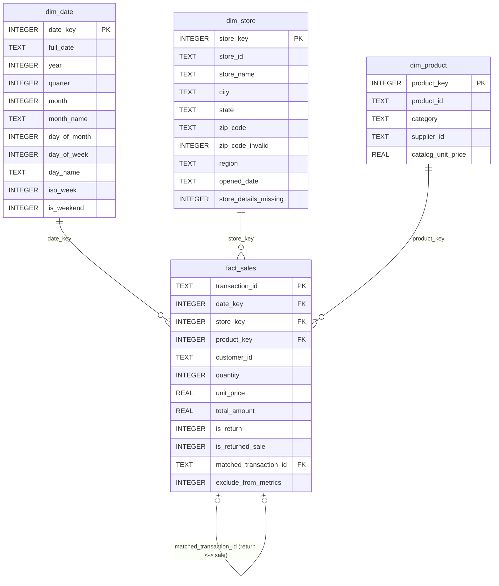

# Warehouse schema: `warehouse.db`

A SQLite star schema built from the validated stores, products and transactions tables.

|              |                                                                                                                        |
| ------------ | ---------------------------------------------------------------------------------------------------------------------- |
| **Database** | `data/warehouse.db` (SQLite)                                                                                           |
| **Built by** | `notebooks/load_warehouse.ipynb`, from `data/validated/*.csv`                                                          |
| **Cleaning** | `notebooks/data_cleaning.ipynb`, from `data/raw/*.csv` (log in `data/validated/cleaning_log.csv`)                      |
| **Rebuild**  | Run `data_cleaning.ipynb`, then `load_warehouse.ipynb`. The database is deleted and rebuilt from scratch on every run. |

---

## 1. Overview



**Placeholder stores:** four stores (S016–S019) have sales but no record in the stores file. They appear in `dim_store` with details set to `Unknown` and `store_details_missing = 1`, so their sales count in totals and show as region `Unknown` in region reports.

**Grain of `fact_sales`:** one row per transaction. Each transaction is one product at one store on one date. Returns are rows of their own, with a negative quantity.

**Conventions**

- Each dimension has an integer surrogate key (`*_key`), numbered in order of the natural ID. The natural ID (`store_id`, `product_id`) is kept as a `UNIQUE` column for joining back to the source data.
- `date_key` is the date as an integer in `YYYYMMDD` form, so `20260404` is 4 April 2026.
- Yes/no flags are `INTEGER` 0/1. SQLite has no boolean type.
- Money is stored as `REAL`, rounded to 2 decimal places. SQLite has no decimal type.
- IDs and `zip_code` are `TEXT`, so leading zeros are kept.
- Primary keys, foreign keys and `CHECK` constraints are declared, so SQLite refuses rows that break them. SQLite only enforces foreign keys on a connection that runs `PRAGMA foreign_keys = ON;`.

---

## 2. Tables

### `fact_sales`

| Column                   | Type        | Key                | Description                                                                           |
| ------------------------ | ----------- | ------------------ | ------------------------------------------------------------------------------------- |
| `transaction_id`         | TEXT        | PK                 | Transaction ID from the source, e.g. `TXN10011` (degenerate dimension)                |
| `date_key`               | INTEGER     | FK → `dim_date`    | Transaction date, `YYYYMMDD`                                                          |
| `store_key`              | INTEGER     | FK → `dim_store`   | Store                                                                                 |
| `product_key`            | INTEGER     | FK → `dim_product` | Product                                                                               |
| `customer_id`            | TEXT        |                    | Customer ID from the source (degenerate dimension). `NULL` where none was recorded    |
| `quantity`               | INTEGER     |                    | Units. Negative for a return. Never 0                                                 |
| `unit_price`             | REAL        |                    | Price per unit on the transaction                                                     |
| `total_amount`           | REAL        |                    | Transaction amount (`$` removed during cleaning). Negative for a return               |
| `is_return`              | INTEGER 0/1 |                    | 1 = this row is a return (negative quantity)                                          |
| `is_returned_sale`       | INTEGER 0/1 |                    | 1 = this row is the sale that a return reverses                                       |
| `matched_transaction_id` | TEXT        | FK → `fact_sales`  | For a return: the sale it reverses. For a returned sale: its return. Otherwise `NULL` |
| `exclude_from_metrics`   | INTEGER 0/1 |                    | 1 = leave out of revenue and other metrics (`is_return OR is_returned_sale`)          |

Indexes are on `date_key`, `store_key` and `product_key`.

### `dim_date`

There is one row per calendar day, from the first transaction date to the last, with no gaps. Days without sales appear in reports as zero instead of being skipped.

| Column         | Type        | Key    | Description             |
| -------------- | ----------- | ------ | ----------------------- |
| `date_key`     | INTEGER     | PK     | `YYYYMMDD`              |
| `full_date`    | TEXT        | unique | `YYYY-MM-DD`            |
| `year`         | INTEGER     |        | e.g. 2026               |
| `quarter`      | INTEGER     |        | 1–4                     |
| `month`        | INTEGER     |        | 1–12                    |
| `month_name`   | TEXT        |        | e.g. `April`            |
| `day_of_month` | INTEGER     |        | 1–31                    |
| `day_of_week`  | INTEGER     |        | 1 = Monday … 7 = Sunday |
| `day_name`     | TEXT        |        | e.g. `Saturday`         |
| `iso_week`     | INTEGER     |        | ISO week number, 1–53   |
| `is_weekend`   | INTEGER 0/1 |        | 1 = Saturday or Sunday  |

### `dim_store`

| Column                  | Type        | Key    | Description                                                                      |
| ----------------------- | ----------- | ------ | -------------------------------------------------------------------------------- |
| `store_key`             | INTEGER     | PK     | Surrogate key                                                                    |
| `store_id`              | TEXT        | unique | Store ID from the source, e.g. `S007`                                            |
| `store_name`            | TEXT        |        |                                                                                  |
| `city`                  | TEXT        |        |                                                                                  |
| `state`                 | TEXT        |        | Two-letter state code                                                            |
| `zip_code`              | TEXT        |        | Exactly as in the source. Not corrected (see §4). `NULL` for placeholder stores  |
| `zip_code_invalid`      | INTEGER 0/1 |        | 1 = `zip_code` is not exactly 5 digits                                           |
| `region`                | TEXT        |        | e.g. `West`. The two OR stores were filled during cleaning (see §4)              |
| `opened_date`           | TEXT        |        | Exactly as in the source. `NULL` for placeholder stores                          |
| `store_details_missing` | INTEGER 0/1 |        | 1 = placeholder store: it has transactions but isn't in the stores file (see §4) |

### `dim_product`

| Column               | Type    | Key    | Description                                                 |
| -------------------- | ------- | ------ | ----------------------------------------------------------- |
| `product_key`        | INTEGER | PK     | Surrogate key                                               |
| `product_id`         | TEXT    | unique | Product ID from the source, e.g. `P005`                     |
| `category`           | TEXT    |        | The 5 blank categories were filled during cleaning (see §4) |
| `supplier_id`        | TEXT    |        | Each supplier maps to exactly one category                  |
| `catalog_unit_price` | REAL    |        | Catalog price, always above 0 (see §3.1)                    |

`product_name` is not in the warehouse (see §3.3).

### `v_sales_reportable` (view)

`SELECT * FROM fact_sales WHERE exclude_from_metrics = 0`. This view is the sales to use for revenue and other metrics.

---

## 3. Decisions

The reasoning in this section is the reasoning given during the data review.

### 3.1 Products with more than one price on record

| Product | Issue                                                       | Decision                                                                                       | Reasoning                                             |
| ------- | ----------------------------------------------------------- | ---------------------------------------------------------------------------------------------- | ----------------------------------------------------- |
| `P005`  | Appeared twice in the product catalog with different prices | Kept the row whose price matches the `unit_price` in the transactions table. Dropped the other | Only one matches the price in the transactions table. |
| `P027`  | Catalog price was 0.00                                      | Replaced the price with the `unit_price` from the transactions table                           | It has a price in the transactions table.             |

As a result, every product appears once in `dim_product` and has a catalog price above 0.

The two prices are stored separately. `dim_product.catalog_unit_price` is the catalog price, and `fact_sales.unit_price` is the price the transaction was actually charged at. For revenue, use `fact_sales.total_amount`, not the catalog price.

### 3.2 Returns (negative transactions)

All negative values are returns. Each one matches an earlier sale with the same store, product, customer and date.

**Decision:** returns are kept in `fact_sales`. Each return and the sale it reverses are flagged:

- `is_return = 1` on the return
- `is_returned_sale = 1` on the matching sale
- `matched_transaction_id` links each row to the other
- `exclude_from_metrics = 1` on both

**Reasoning:** so that they aren't counted in revenue or other metrics, but aren't dropped, so they can still be tracked as needed.

**Notes**

- Each return is matched to one sale. If there are several candidates, the sale with the same quantity is preferred, then the earliest `transaction_id`.
- In a partial return (for example 1 unit returned out of 4 sold), the whole sale is flagged, as decided.

```sql
-- Revenue: returns and the sales they reverse are left out
SELECT ROUND(SUM(total_amount), 2) AS revenue FROM v_sales_reportable;

-- Each return next to the sale it reverses
SELECT r.transaction_id AS return_id, s.transaction_id AS sale_id,
       r.quantity AS returned_qty, s.quantity AS sold_qty, s.total_amount AS sale_amount
FROM fact_sales r
JOIN fact_sales s ON s.transaction_id = r.matched_transaction_id
WHERE r.is_return = 1;
```

### 3.3 Columns not loaded

| Column         | Source table | Reasoning                                                                                                                                  |
| -------------- | ------------ | ------------------------------------------------------------------------------------------------------------------------------------------ |
| `product_name` | products     | It's just the `product_id` with "product" at the start as a prefix. The load checks this is true for every row before dropping the column. |

---

## 4. Records excluded from the warehouse

| Records                                                          | Source table | Count                              | Why excluded                                                                                                                                                                         |
| ---------------------------------------------------------------- | ------------ | ---------------------------------- | ------------------------------------------------------------------------------------------------------------------------------------------------------------------------------------ |
| Second row for store `S007` (same store, different `store_name`) | stores       | 1                                  | It's the same record. The first row in file order is kept.                                                                                                                           |
| Exact duplicate rows                                             | products     | all found (see `cleaning_log.csv`) | — _(no reasoning given)_                                                                                                                                                             |
| `P005` row whose price doesn't match transactions                | products     | 1                                  | Only one of the two `P005` rows matches the price in the transactions table.                                                                                                         |
| Exact duplicate rows                                             | transactions | 15                                 | — _(no reasoning given)_                                                                                                                                                             |
| Transactions with `quantity` and `total_amount` both 0           | transactions | 5                                  | We drop them so they don't skew average transaction value or revenue tracking. They are saved to `data/validated/transactions_dropped_zero_quantity.csv` and flagged for the client. |

### Kept, but flagged or changed

These records are **in** the warehouse, either flagged or corrected during cleaning:

| Records                                                                                                        | Table         | Count                                                 | What was done                                                                                                                                                                                                                                                   | Reasoning                                                                                                                                                                                                                                                                           |
| -------------------------------------------------------------------------------------------------------------- | ------------- | ----------------------------------------------------- | --------------------------------------------------------------------------------------------------------------------------------------------------------------------------------------------------------------------------------------------------------------- | ----------------------------------------------------------------------------------------------------------------------------------------------------------------------------------------------------------------------------------------------------------------------------------- |
| Returns and the sales they reverse                                                                             | `fact_sales`  | all negative-quantity rows, plus their matching sales | Flagged with `exclude_from_metrics = 1`                                                                                                                                                                                                                         | So they aren't counted in revenue or other metrics, but can still be tracked as needed.                                                                                                                                                                                             |
| Invalid zip codes                                                                                              | `dim_store`   | 2                                                     | Kept as stored. Flagged with `zip_code_invalid = 1`                                                                                                                                                                                                             | It's too risky to impute new zips without being sure. If zip code isn't needed for analytics, it's safe to keep in the data for now. `zip_code` is text so leading or trailing zeros can't be cut off.                                                                              |
| Stores S016, S017, S018 and S019, which have transactions but aren't in the stores file (not even the raw one) | `dim_store`   | 4 stores (5 transactions)                             | Added as placeholder stores: `store_name`, `city`, `state` and `region` are `Unknown`, `zip_code` and `opened_date` are `NULL`, and `store_details_missing = 1`. Their sales are kept. Listed for the client in `data/validated/stores_missing_from_source.csv` | — _(no reasoning given)_                                                                                                                                                                                                                                                            |
| Blank `region` on the two OR stores                                                                            | `dim_store`   | 2                                                     | Filled with `West`                                                                                                                                                                                                                                              | Based on the other state/region columns, we can impute the region "West".                                                                                                                                                                                                           |
| Blank `category`                                                                                               | `dim_product` | 5                                                     | Filled from the category of other products with the same `supplier_id`                                                                                                                                                                                          | Each supplier maps to exactly one category.                                                                                                                                                                                                                                         |
| `$` in `total_amount`                                                                                          | `fact_sales`  | all with `$`                                          | `$` removed, then cast to a decimal number                                                                                                                                                                                                                      | — _(no reasoning given)_                                                                                                                                                                                                                                                            |
| Dates in mixed formats                                                                                         | `fact_sales`  | all                                                   | Cast to `YYYY-MM-DD`. Values where day and month are both ≤ 12 were resolved one by one                                                                                                                                                                         | The dates range from March to June: `01-04-2026` (TXN10011) is April 1st; `04/12/2026` and `04/01/2026` are April; `05/07/2026` is May; `12-03-2026` is March; `05/05/2026` can go either way, so it doesn't matter. That leaves one record, `06-04-2026`, which is June 4th, 2026. |

---

## 5. Example queries

```sql
-- Reportable revenue by region and month
SELECT s.region, d.year, d.month_name, ROUND(SUM(f.total_amount), 2) AS revenue
FROM v_sales_reportable f
JOIN dim_store s USING (store_key)
JOIN dim_date  d USING (date_key)
GROUP BY s.region, d.year, d.month
ORDER BY s.region, d.year, d.month;

-- Average transaction value by product category
SELECT p.category, ROUND(AVG(f.total_amount), 2) AS avg_transaction_value, COUNT(*) AS transactions
FROM v_sales_reportable f
JOIN dim_product p USING (product_key)
GROUP BY p.category
ORDER BY avg_transaction_value DESC;

-- Stores whose zip code needs checking
SELECT store_id, store_name, zip_code FROM dim_store WHERE zip_code_invalid = 1;

-- Sales at stores with no store details (placeholder stores)
SELECT s.store_id, COUNT(*) AS transactions, ROUND(SUM(f.total_amount), 2) AS amount
FROM fact_sales f JOIN dim_store s USING (store_key)
WHERE s.store_details_missing = 1
GROUP BY s.store_id;
```
